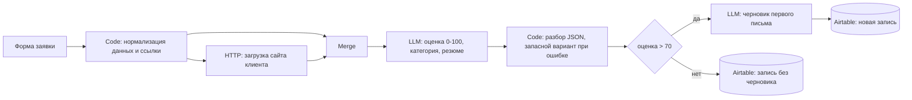

# AI Lead Platform

Сценарий n8n, который автоматически оценивает входящие заявки с сайта по шкале 0–100, классифицирует их и готовит черновик первого письма для перспективных лидов. Результат сохраняется в Airtable.

**Стек:** n8n, Airtable, LLM через OpenRouter, JavaScript (узлы Code).

> **Статус.** Демонстрационный прототип. Сейчас использует облачные модели через API.

## Как это работает

1. Форма принимает имя, e-mail и необязательную ссылку на сайт или портфолио.
2. Если ссылка есть, система загружает страницу и передаёт первые 3500 символов в LLM.
3. LLM возвращает оценку, категорию (`B2B_QUALIFIED`, `DIRECT_INBOUND`, `SPAM_OR_LOW_FIT`), краткое резюме, название компании и рекомендуемый подход к клиенту. Если ответ модели не удалось разобрать, лид получает оценку 50 и статус `REVIEW` для ручной проверки.
4. Лиды с оценкой выше 70 получают персонализированный черновик письма. Все лиды записываются в Airtable.

## Состав репозитория

- `workflows/ai-lead-platform.json`: сценарий n8n.

Поля в Airtable: Lead Name, Company, Email, Phone, Website, Lead Source, Status, Category, Lead Score, AI Summary, Outreach Draft.

## Как запустить

1. Установите n8n и импортируйте `workflows/ai-lead-platform.json` через *Import from File*.
2. Создайте в n8n свои credentials: OpenRouter и Airtable. В репозитории их нет, узлы после импорта покажут, где их указать.
3. Создайте таблицу в Airtable с полями из списка выше. В обоих узлах Airtable замените `YOUR_AIRTABLE_BASE_ID` и `YOUR_AIRTABLE_TABLE_ID` на свои.
4. Активируйте сценарий и отправьте тестовую заявку через форму.

## Известные ограничения и план доработок

- **Telegram.** Узел уведомления менеджеру есть на схеме, но не настроен и не подключён. Сейчас результат виден только в Airtable.
- **Безопасность.** Сервер загружает любой URL из формы. Нужна проверка адресов, чтобы закрыть доступ к внутренним ресурсам. Если ссылки нет, загрузка идёт на заглушку `httpbin.org`.
- **Облачные модели.** Данные заявок уходят во внешний API.

## Что не публикуется

В репозитории нет ключей, идентификаторов credentials и идентификаторов Airtable. `.gitignore` защищает от случайного добавления `.env`, дампов и CSV.
